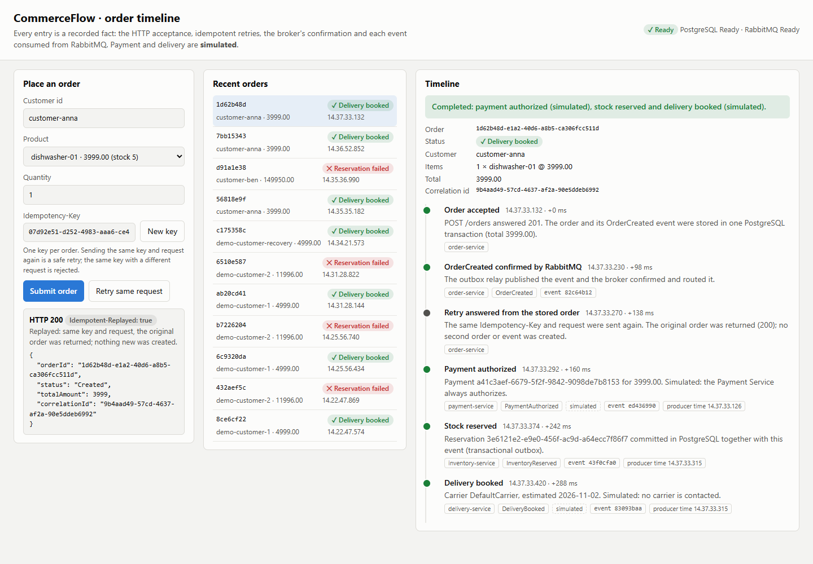

# Recruiter quick review — CommerceFlow

**What it demonstrates:** Event-driven services, TypeScript / Node.js, RabbitMQ, PostgreSQL, Docker, transactional outbox, idempotency, at-least-once delivery and recovery from component failures.

**Cost:** Free local demo using Docker. No cloud subscription or credentials for external services are needed.

## First look without installing anything



- [System architecture and event flow](../README.md#architecture)
- [Reliability guarantees](../README.md#reliability-and-delivery-guarantees)
- [Order timeline documentation](order-timeline.md)
- [Detailed developer walkthrough](PROJECT_WALKTHROUGH.md)
- [Documented limitations](../README.md#known-limitations)

## Try it on your machine

Requirements: Node.js 22 or 24, npm and Docker with Docker Compose. The local Docker engine must be running. The repository's demo uses development-only credentials and local data, not production accounts.

```bash
git clone https://github.com/kris7011/commerce-flow.git
cd commerce-flow
npm ci
npm run stack:up
npm run demo
npm run status
```

Open **http://localhost:3001/** to view the order timeline. The scripted demo exercises an order, an idempotent retry, a duplicate event and validation. It performs assertions and fails if its expectations are not met.

To observe recovery from failure against the disposable **local demo environment**, run:

```bash
npm run demo:recovery
```

This scenario intentionally disrupts the demo's PostgreSQL infrastructure before restoring it. Do not point the demo at a shared or production database.

When finished:

```bash
npm run stack:down
```

The existing GitHub CI runs the system in containers and checks its reliability flows. This guide documents that workflow; it does not claim a new local execution.

## Five-minute code-review tour

1. **Start with the HTTP order request.** Follow how an idempotency key ensures a retry returns the same order.
2. **Follow events across five services.** Order, Payment, Inventory, Delivery and Notification communicate through RabbitMQ rather than direct synchronous service calls.
3. **Look at the transactional outbox.** An event is stored with the database state change and only considered published after a broker acknowledgement and successful routing.
4. **Review failure recovery.** Read [reliability notes](reliability.md), inspect the dead-letter handling and run the recovery demo on an isolated stack.
5. **Verify the test strategy.** The original CI includes tests against real RabbitMQ/PostgreSQL and a container-based full-stack demo; unit and type checks also run across Node versions.

## What the demo does not prove

Payments and delivery are simulated. The system intentionally provides **at-least-once**, not exactly-once, delivery semantics. It is an engineering portfolio project, not a payment-processing service or production deployment. See [known limitations](../README.md#known-limitations).

**For an interview:** discuss what happens between a successful PostgreSQL commit and a failed RabbitMQ publication, why consumers must be idempotent, and how poison messages can be recovered without double-processing an order.
