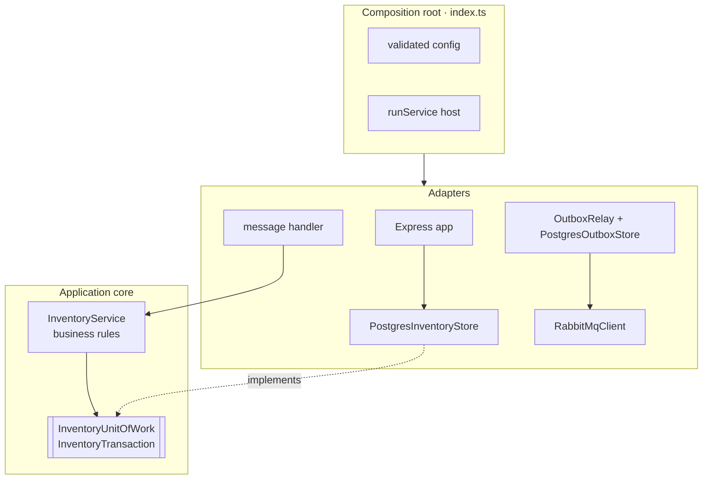

# Architecture

This document describes how CommerceFlow is structured internally. The [README](../README.md) gives the overview, and [reliability.md](reliability.md) covers failure handling.

## Service boundaries

Each service owns one step of the workflow and talks to the others only through events. No service calls another over HTTP, and no two services share a database.

| Service | Owns | Why it is separate |
|---|---|---|
| Order | Accepting and validating orders | The public entry point; must answer quickly and independently of downstream steps |
| Payment | Payment authorization (simulated) | In a real system this integrates with a payment provider with its own failure modes |
| Inventory | Stock and reservations | The only service with durable business state; it must never oversell |
| Delivery | Delivery booking (simulated) | Integrates with carriers in a real system |
| Notification | Customer-facing messages | Reacts to outcomes from several services |

## Layers inside a service



* **The application core** (`inventoryService.ts`) decides whether a reservation succeeds and builds the resulting event. It imports only contract types and its own ports.
* **Ports** (`inventoryStore.ts`) describe what the core needs from persistence: lock the order, lock stock, decrement stock, record the outcome and enqueue an event, all within one `inTransaction` call.
* **Adapters** implement those ports for PostgreSQL and in memory. The in-memory adapter keeps the transactional contract (serialised transactions, rollback on throw), so unit tests exercise the same rules.
* **The composition root** wires concrete adapters, reads configuration and hands background tasks to the service host.

The stateless services follow the same pattern with fewer moving parts: a pure service class (`PaymentService`, `DeliveryService`, `NotificationService`), a message handler with an injected publisher and logger, an Express app for health endpoints, and an `index.ts`.

Ports exist only where they pay off: where there are several implementations, or where business rules have to be kept free of infrastructure. There is no DI container; dependencies are passed explicitly to constructors and factory functions.

## Shared packages

| Package | Contents | Notes |
|---|---|---|
| `@commerce-flow/contracts` | Event types, zod schemas, `ROUTING_KEYS`, `deriveDeterministicId` | Single source of truth for message shape and routing |
| `@commerce-flow/messaging` | `RabbitMqClient`, `RabbitMqSupervisor`, `PermanentMessageError` | Confirms, retries, DLQ, prefetch, drain |
| `@commerce-flow/logging` | Structured JSON logger with child contexts | Errors are serialised; no payloads are logged |
| `@commerce-flow/runtime` | Configuration readers, `runService` | Graceful, bounded shutdown on SIGTERM/SIGINT |
| `@commerce-flow/testing` | Isolated test databases | Destructive operations are guarded by a name check |

## Messaging layer

`RabbitMqClient` wraps amqplib and holds one connection with one **confirm channel**.

* **On every (re)connect** the client declares the exchange and, if configured, the complete queue topology (`COMMERCE_TOPOLOGY`), so events can be routed before their consumers have ever started.
* **`publish(routingKey, event)`** connects if needed and publishes a persistent, **mandatory** message with `messageId`, `correlationId` and `type`. It resolves only when the broker has acked the message and has not returned it as unroutable (`ConfirmedPublisher` correlates `basic.return` with its publication). A return, a nack, a channel closing before the confirm, or the publish timeout reject with the event id and routing key in the message.
* **`subscribe({ queueName, routingKeys, parseEvent, handler })`** declares the durable topic exchange, the queue with its dead-letter exchange and queue, and the bindings. It then sets the prefetch and starts consuming. Every delivery is decoded and validated with `parseEvent`; invalid messages are dead-lettered. The handler is retried with exponential backoff for transient errors and the message is dead-lettered after the last attempt. The message is acknowledged only after the handler succeeds.
* **`close()`** cancels the consumers, waits (bounded) for in-flight handlers, then closes the channel and connection. Unacknowledged messages return to their queues.

`RabbitMqSupervisor` runs as a background task. While the client is not ready, it calls an initialisation function (connect and subscribe) with retries, so a service that starts during a broker outage, or loses the broker later, recovers by itself. Readiness (`/ready`) reflects the supervisor's view.

## Service host

`runService` (in `@commerce-flow/runtime`) gives every service the same lifecycle:

```mermaid
sequenceDiagram
    participant OS as Process / orchestrator
    participant H as runService
    participant S as HTTP server
    participant T as Background tasks
    participant R as Resources (stop)

    H->>H: start() — e.g. migrations
    H->>S: listen
    H->>T: run(signal) — supervisor, outbox relay
    OS->>H: SIGTERM
    H->>S: close (stop accepting)
    H->>T: abort signal, await completion
    H->>R: stop() — drain consumers, close broker and pool
    H->>OS: exit 0
    note over H: forced exit if this exceeds the timeout;<br/>a crashed background task exits non-zero
```

## Persistence

Inventory Service owns four tables, created by versioned migrations (`src/migrations.ts`):

| Table | Purpose | Key constraints |
|---|---|---|
| `inventory_stock` | Current quantity per product | `CHECK (quantity >= 0)` |
| `inventory_reservations` | One outcome per order (idempotency record) | `PRIMARY KEY (order_id)`; `reservation_id` set if and only if the status is `Reserved` |
| `inventory_outbox` | Events waiting for publication | `UNIQUE (event_id)`; partial index on pending rows; `attempts >= 0` |
| `inventory_schema_migrations` | Applied migration versions | – |

All pending migrations run in one transaction under an advisory lock. Concurrent service instances therefore migrate safely, and a failed migration leaves the schema untouched. Migrations are forward-only; a released migration is never edited.

## Correlation and logging

Order Service creates (or accepts) a correlation id. Every event carries it, every consumer copies it into the events it emits, and every log line about the order includes it. Logs are JSON lines, so one order can be followed across all five services by filtering on `correlationId`.
