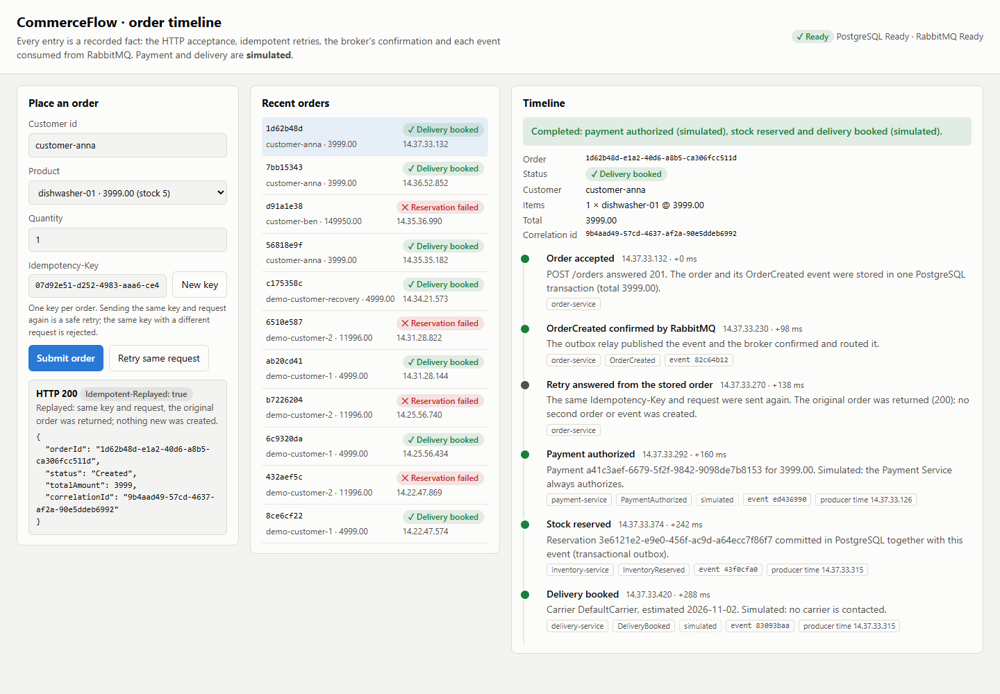
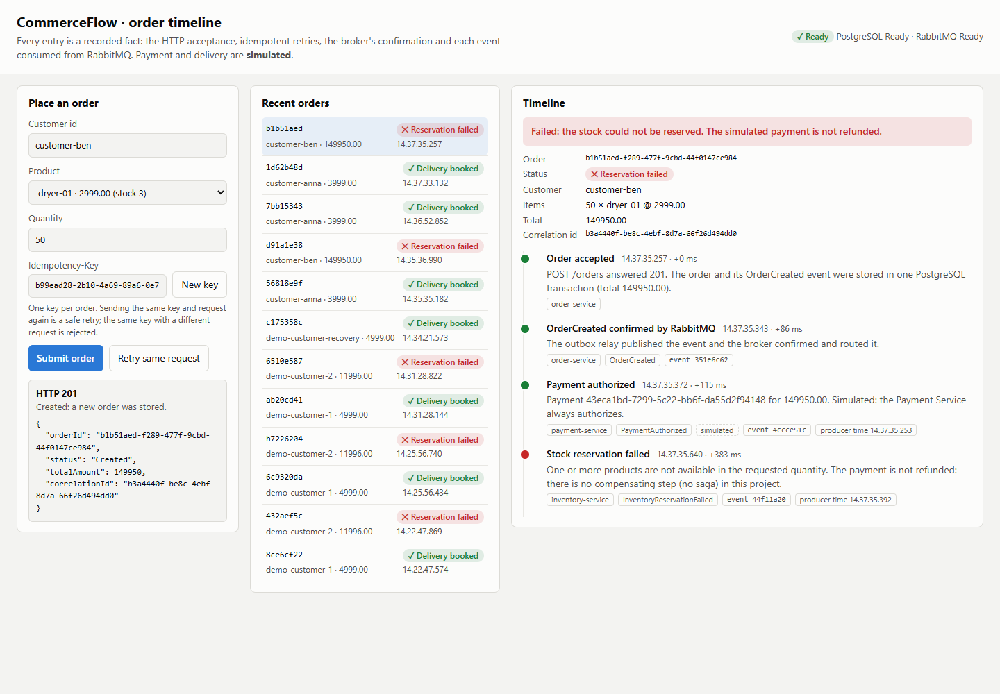

# Durable, idempotent orders and the order timeline

Version 1.1 gives the Order Service a database. This closes the gap that
the 1.0 README listed as a known limitation (a lost broker confirm followed
by a client retry created a second order) and makes the workflow of every
order visible.



## What changed for clients

`POST /orders` now requires an `Idempotency-Key` header: one new value
(typically a UUID) per order, and the **same** value when retrying that
order.

| Request | Answer |
|---|---|
| New key | `201 Created` |
| Same key, same request | `200`, the original body, header `Idempotent-Replayed: true` |
| Same key, different request | `422` |
| Missing or invalid key (not 1–255 visible ASCII characters) | `400` |
| PostgreSQL unavailable | `503` + `Retry-After: 5`; retry with the same key |

The `201`/`200` body is the creation result
(`{orderId, status: "Created", totalAmount, correlationId}`) and is
identical for the first answer and every replay. The current workflow
status is at `GET /orders/{orderId}`.

RabbitMQ is no longer on the request path: an order is accepted while the
broker is down and its `OrderCreated` event is published when it is back.

## How a submission is stored

```text
POST /orders ── validate key and body ── OrderService.createOrder (ids, event, fingerprint)
     │
     ▼  PostgresOrderStore.submitOrder — one transaction
  INSERT INTO orders ... ON CONFLICT (idempotency_key) DO NOTHING
     ├─ inserted → INSERT order_outbox (OrderCreated) + order_timeline ('Accepted') → 201
     └─ conflict → SELECT the stored order
                   ├─ same fingerprint → INSERT order_timeline ('Replayed') → 200
                   └─ other fingerprint → 422 (nothing written)
     ▼
  OutboxRelay (shared with Inventory) → RabbitMQ with publisher confirms → mark published
```

* **Fingerprint.** SHA-256 of the canonical request (`customerId`, then each
  item's `productId`, `quantity`, `unitPrice`, in order). Unknown fields
  and key order do not change it; any value or the item order does
  (`fingerprintOrderRequest` in `orderService.ts`).
* **Concurrency.** The unique index decides. A second transaction with the
  same key waits on the first one's insert; if the first commits, the
  second finds its order (`Replayed` or `KeyReused`); if it rolls back,
  the second inserts.
* **Atomicity.** The order, its outbox event and the `Accepted` entry are
  committed together. A crash after the commit cannot lose the event; a
  crash before it leaves nothing behind, and the client's retry with the
  same key creates the order once.

## How the timeline is built

Order Service subscribes to its own queue, `order-service.order-events`,
bound to `payment.authorized`, `inventory.reserved`,
`inventory.reservation.failed` and `delivery.booked`
(`QUEUES.orderWorkflowEvents` in `shared/contracts`). For each event,
`PostgresOrderStore.recordWorkflowEvent`:

1. locks the order row (`FOR UPDATE`), so events for one order are applied
   one at a time;
2. inserts a timeline row, unique by event id; a redelivery increments
   `deliveries` instead (`ON CONFLICT (event_id) DO UPDATE`);
3. moves the status forward with `applyWorkflowEvent`
   (`Created → PaymentAuthorized → InventoryReserved → DeliveryBooked`, or
   `InventoryReservationFailed`, which is final). A late or repeated event
   never moves it back.

Events for an unknown order are logged and acknowledged (a retry could not
help: an order always exists before its `OrderCreated` is published).

`GET /orders/{orderId}` returns `buildOrderTimeline(details)` from
`orderTimeline.ts`: the order, its outcome (`InProgress`, `Completed`,
`Failed`), a summary, and entries:

| Entry | Source | Notes |
|---|---|---|
| Order accepted | `order_timeline` (`Accepted`) | committed with the order |
| Retry answered from the stored order | `order_timeline` (`Replayed`) | one per idempotent retry |
| OrderCreated confirmed by RabbitMQ | `order_outbox.published_at` | or *waiting in the outbox* with attempts and the last error |
| Payment authorized | `PaymentAuthorized` | labelled **simulated** |
| Stock reserved / Stock reservation failed | `InventoryReserved` / `InventoryReservationFailed` | the failure says the simulated payment is not refunded (no saga) |
| Delivery booked | `DeliveryBooked` | labelled **simulated** |

Each entry has the service, the time the Order Service observed it (one
database clock, so offsets are comparable), the producer's own timestamp,
the event id and, when above one, the number of broker deliveries.
Entries are ordered by workflow stage: producer timestamps are not a safe
ordering key, because Payment and Delivery copy theirs from the source
event so that a redelivery re-emits an identical event. This was found
in the container demo, where "Payment authorized" first appeared before
"Order accepted"; a unit test now covers it.

## The page

`GET /` on the Order Service serves a small page (plain HTML, CSS and an
ES module in `services/order-service/public/`, no build step, a strict
Content-Security-Policy, text inserted with `textContent` only):

* a form that generates an `Idempotency-Key`, with **Retry same request**
  to show a replay and **New key** for the next order (changing the order
  and submitting with the old key shows the `422`);
* the 20 most recent orders with their status;
* the selected order's timeline, refreshed every second until it is
  complete.



## Data and operations

* Tables: `orders`, `order_timeline`, `order_outbox`, migrations in
  `order_schema_migrations` (`services/order-service/src/migrations.ts`).
  They share the PostgreSQL database with Inventory but have their own
  prefix, migration history and advisory lock.
* `GET /diagnostics/outbox` shows the order outbox backlog, as for Inventory.
* Backup and restore: the order tables are in the same database as
  Inventory's, so `pg_dump`/`pg_restore` of `commerce_flow` covers both.
  After restoring an older dump, the relay re-publishes events that were
  published after the dump was taken; every consumer is idempotent, so
  this causes duplicates, not duplicate effects. (Not exercised by a test.)

## Tests

| Level | File | What it shows |
|---|---|---|
| Unit | `services/order-service/tests/orderApp.test.ts` | 201, replay 200, 422, invalid keys, 503 with `Retry-After`, list, timeline, 404, the page and its CSP |
| Unit | `services/order-service/tests/orderWorkflow.test.ts` | status rules, fingerprint, key validation, event parsing, duplicate counting, timeline wording and causal order |
| Integration (PostgreSQL, RabbitMQ) | `services/order-service/tests/orderPersistence.integration.test.ts` | 20 concurrent submissions with one key → 1 order and 1 outbox event; concurrent key reuse; 8 concurrent HTTP retries → one 201; 10 concurrent redeliveries → one entry with `deliveries = 10`; out-of-order events; relay publication and the unroutable case |
| End to end (all services as processes) | `tests/e2e/commerceFlow.e2e.test.ts`, `rabbitMqRecovery.e2e.test.ts` | an idempotent retry and both timelines; an order accepted while RabbitMQ is down completes after recovery |
| Full stack (containers) | `npm run demo` | retry → 200 with the same order, stock decreases once, the timeline shows the completed workflow |

## Limitations

* Keys are global and never expire (no authentication to scope them).
* The timeline is eventually consistent and shows only published events;
  Notification Service publishes none, so it is not on the timeline.
* No compensation: a failed reservation leaves the simulated payment
  authorized, and the timeline says so.
