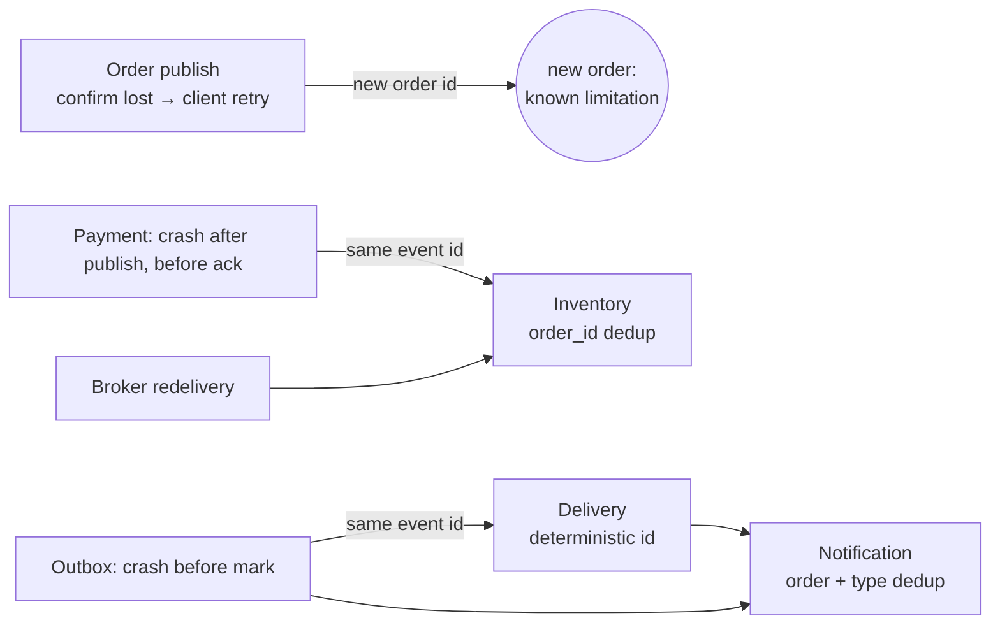

# Reliability

This document lists the failures CommerceFlow is designed to survive, how each one is handled and which test proves it. The guiding rule is **at-least-once delivery with idempotent consumers**: a message may arrive more than once, but it must never be lost and must never have its business effect applied twice.

## The consistency problem the outbox solves

Before the outbox, Inventory Service committed a reservation and then published `InventoryReserved`. Either order of those two steps leaves a window:

| Order | Crash between the steps | Result |
|---|---|---|
| commit → publish | after commit | stock reserved, nobody is told; the order hangs forever |
| publish → commit | after publish | delivery booked for stock that was never reserved |

The transactional outbox removes the window: the event is a row written **in the same transaction** as the stock change. Publication becomes a separate, retryable step that reads committed rows.

## Inventory transaction

```text
BEGIN
  SELECT pg_advisory_xact_lock(hashtextextended('…inventory-order:' || order_id, 0))
  SELECT … FROM inventory_reservations WHERE order_id = $1   -- already processed? → return outcome
  SELECT … FROM inventory_stock WHERE product_id = ANY($1) ORDER BY product_id FOR UPDATE
  UPDATE inventory_stock … (only if every item is available)
  INSERT INTO inventory_reservations (order_id, status, …)    -- PK = idempotency backstop
  INSERT INTO inventory_outbox (event_id, routing_key, payload, …)
COMMIT
```

* The **advisory lock** makes concurrent duplicates wait for the first transaction to finish and then see its result, so they never race it.
* **Row locks in a fixed order** prevent both overselling and deadlocks between reservations that touch overlapping products.
* The **primary key** on `order_id` rejects a second outcome even if the lock were bypassed; the transaction then rolls back and the retry sees the duplicate.
* The **`CHECK (quantity >= 0)`** constraint is a last line of defence against negative stock.

## Routing guarantees

A publisher confirm means the broker has taken responsibility for a message. It does **not** mean that any queue received it: RabbitMQ positively confirms a message that matches no binding and then discards it. Without further measures an outbox event would be marked as published and lost, and the Order Service would answer `201` for an order nobody will ever process.

Two complementary measures close this gap:

1. **Provisioned topology.** `COMMERCE_TOPOLOGY` (in `@commerce-flow/contracts`) lists every consumer queue and its routing keys. Every service declares it idempotently on each (re)connect, using the same declaration code as `subscribe()`, so arguments always match. Events wait in durable queues even if their consumer has never started.
2. **Mandatory publishing with correlated returns.** Every message is published with `mandatory: true` and a unique `x-publication-id` header. RabbitMQ sends `basic.return` for an unroutable message *before* the `basic.ack` on the same channel, and amqplib processes frames in order, so when a publication's confirm arrives its return (if any) has already been recorded. Such a publication is rejected with `UnroutableMessageError`. Correlation uses the header rather than the message id, because the same event can legitimately be published twice concurrently.

| Publishing path | Effect of an unroutable message |
|---|---|
| Inventory and Order outbox relays | The event stays pending with `last_error` and is retried with backoff until a queue exists; the order or reservation is kept |
| Payment, Delivery handlers | The handler fails, so the input message is not acknowledged: it is retried and finally dead-lettered |

## Deterministic re-emission

Payment and Delivery hold no state, so after a crash between "publish" and "ack" they process the input message again. Their output is a pure function of the input event: ids are derived with `deriveDeterministicId`, `occurredAt` is taken from the source event, and the estimated delivery date is the reservation date plus three days. A re-emitted event is therefore byte-identical to the original, also when the redelivery happens on a later date. The same event id never carries two different outcomes.

## Outbox relay

| Step | Statement | Why |
|---|---|---|
| Claim | `UPDATE … SET available_at = now() + lease, claimed_by = $relay, attempts = attempts + 1 WHERE sequence_id IN (SELECT … WHERE published_at IS NULL AND available_at <= now() ORDER BY sequence_id LIMIT $n FOR UPDATE SKIP LOCKED)` | One short statement; concurrent relays skip each other's rows instead of waiting |
| Publish | `publish()` on a confirm channel, whole batch in parallel | No database transaction is open during network I/O |
| Mark published | `UPDATE … SET published_at = now() WHERE sequence_id = ANY($1) AND published_at IS NULL` | Only after the broker confirm; idempotent |
| Reschedule failure | `UPDATE … SET available_at = now() + backoff, last_error = $e WHERE sequence_id = $1 AND claimed_by = $relay AND attempts = $attempts` | `attempts` fences out relays whose lease already expired |

The relay wakes up when the handler commits a new event (`notify()`) and otherwise polls every second. After a failed cycle (for example, the database is down), it waits with exponential backoff.

## Failure modes

| Failure | Behaviour | Test |
|---|---|---|
| Insufficient stock | `InventoryReservationFailed` stored durably; stock untouched | `postgresInventoryStore.integration` · *durably records InventoryReservationFailed* |
| Exception after the stock update, inside the transaction | Full rollback: no stock change, no reservation, no event | `postgresInventoryStore.integration` · *rolls back stock and outbox writes* |
| Concurrent orders for scarce stock | Row locks serialise them; never oversold | `postgresInventoryStore.integration` · *never oversells* |
| Same `PaymentAuthorized` delivered concurrently | One transaction processes it; the others return `Duplicate` | `postgresInventoryStore.integration` · *concurrent redeliveries* |
| Logically duplicate event with a new event id | Detected by order id; no second reservation | unit, integration and E2E · *different event ids* / *re-emitted* |
| Database connection lost mid-transaction | Error event handled; transaction not committed; the pool replaces the client; message retried | `postgresInventoryStore.integration` · *terminated mid-transaction* |
| Database unavailable while handling a message | Handler retried with backoff (5 attempts), then dead-lettered | `rabbitMqClient` unit · *recovers from a transient handler failure* |
| Database terminates the relay's connections | Cycle fails, relay backs off and continues | `outbox.integration` · *keeps relaying after PostgreSQL terminates its connections* |
| RabbitMQ unavailable when publishing from the outbox | Events stay pending with `attempts` and `last_error`; retried with backoff | `outbox.integration` · *keeps events pending while RabbitMQ is unreachable* |
| Relay or process restart with pending events | Any relay instance picks them up | same test (*after a relay restart*) and E2E *Inventory Service crash* |
| Event published before its consumer ever started (fresh broker) | Provisioned topology holds it in a durable queue | `routing.integration` · *provisioned topology*; E2E *orders accepted while every downstream service is offline* |
| Event matches no queue (missing binding) | Mandatory publish is returned; publication fails; outbox keeps it pending | `routing.integration` · *rejects a publication that no queue can receive*; `outbox.integration` · *keeps an unroutable event pending* |
| Queue appears after an unroutable attempt | The retry succeeds; no second reservation | `routing.integration` · *publishes successfully once the destination queue exists*; `outbox.integration` |
| Concurrent publications, some unroutable | Exactly the returned ones fail | `confirmedPublisher` unit; `routing.integration` · *40 concurrent* |
| `OrderCreated` cannot be routed | The order is kept; the event stays pending with its error and is retried | `orderPersistence.integration` · *an OrderCreated event the broker cannot route stays in the outbox* |
| A client retries `POST /orders` (lost response, timeout) | Same `Idempotency-Key` and request → `200` with the original order; nothing new is stored | `orderApp` unit; `orderPersistence.integration` · *20 concurrent submissions* / *over HTTP, concurrent retries*; E2E workflow |
| The same key is reused for a different order | `422`; nothing is stored, also under concurrency | `orderApp` unit; `orderPersistence.integration` · *a key reused for a different order* |
| The order timeline receives an event twice, concurrently or out of order | One entry per event id with a delivery count; the status only moves forward | `orderPersistence.integration` · *concurrent redeliveries* / *out-of-order events* |
| Redelivery to Payment/Delivery on a later date | Byte-identical event | `paymentService` / `deliveryService` unit · *later date* / *after midnight* |
| Broker nacks, or channel closes before the confirm | `publish()` rejects; the event is retried | `rabbitMqClient` unit · *nacks* / *channel closes* |
| Confirm never arrives | `PublishTimeoutError`; retried; the lease exceeds the timeout | `rabbitMqClient` unit · *timeout*; config check `OUTBOX_LEASE_MS ≥ 2 × timeout` |
| Crash after publishing, before marking published | Lease expires; event re-published **with the same event id** | `outbox.integration` · *crashed after publishing but before marking it* |
| Several relays running | Disjoint claims; each event published once when nothing fails | `outbox.integration` · *competing relays* (4 relays, 200 events) |
| Stale relay finishes after its lease expired | Its reschedule is rejected by the `attempts` fence | `outbox.integration` · *fences a relay whose lease expired* |
| Shutdown while a batch is in flight | Batch completes and is marked; then the relay stops | `outbox.integration` · *finishes the in-flight batch* |
| Shutdown while a message handler runs | Consumers cancelled, handler drained (bounded), then ack; no redelivery | `rabbitMqClient.integration` · *finishes in-flight work before closing* |
| Malformed message (invalid JSON or contract violation) | Dead-lettered immediately, handler not called; later messages unaffected | `rabbitMqClient.integration` and E2E · *poison message* |
| Handler keeps failing | Dead-lettered after the last attempt with the original content | `rabbitMqClient.integration` · *exhausts its retries* |
| Ack on a channel that has already closed | Logged; the broker redelivers to a live consumer | `rabbitMqClient` unit · *does not crash when acknowledging on a closed channel* |
| Broker down at service start, or lost later | Services stay alive, `/ready` = 503, supervisor reconnects and resubscribes | E2E · *recovers the complete workflow after RabbitMQ becomes available* |
| Broker down during `POST /orders` | `201`: the order and its event are stored; the relay publishes once the broker is back | E2E · *recovers the complete workflow after RabbitMQ becomes available* (order accepted during the outage) |
| Database down during `POST /orders` | `503` + `Retry-After`; retrying with the same key is safe | `orderApp` unit · *answers 503 with Retry-After when the order cannot be stored* |
| Concurrent schema migrations | Advisory lock; each version applied once | `database.integration` · *serializes concurrent migrations* |
| A migration fails | All pending migrations roll back | `database.integration` · *rolls back every pending migration* |
| Payment or Delivery processes a message twice | The re-emitted event is byte-identical (ids, timestamps, dates) | `paymentService` and `deliveryService` unit · *re-emits an identical event* |
| Notification receives a duplicate | One notification per order and outcome | `notificationEventHandler` unit and E2E |

## Where duplicates can come from, and where they stop



Every path converges on a consumer that recognises the duplicate. The exception is the Order Service retry: without order persistence and an `Idempotency-Key`, a retried request is a new order. This is documented as a [known limitation](../README.md#known-limitations).

## What is deliberately not implemented

* **Exactly-once delivery.** It would require distributed transactions between RabbitMQ and PostgreSQL. Idempotent consumers achieve the business goal more simply.
* **Broker-side delayed retries** (TTL and dead-letter retry queues). In-process backoff is sufficient here; a crash during the backoff just leads to redelivery.
* **Automatic replay of dead-lettered messages.** They wait in `<queue>.dead-letter` for inspection. Once the cause is fixed, an operator replays them with `npm run dlq -- replay <queue>`. The tool publishes each message straight back to its original queue through the default exchange and acknowledges the dead letter only after the broker confirms; at most the messages present at the start are replayed. `npm run demo:recovery` shows the full cycle against a real PostgreSQL outage (see [demo.md](demo.md#npm-run-demorecovery-outage-dead-letter-and-replay)).
* **Outbox pruning, metrics and tracing.** See the README's limitations.
